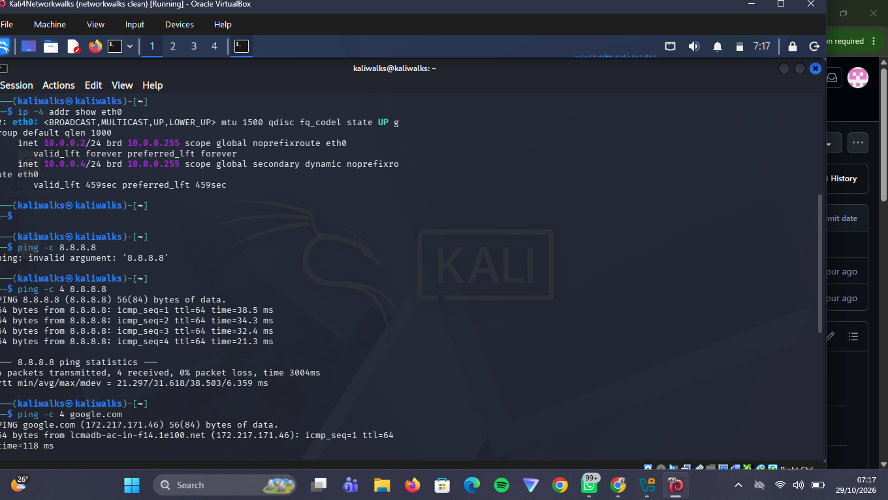

Network Cybersecurity Lab

Project Overview

This project documents the setup and initial network verification of a Kali Linux virtual machine running in Oracle VirtualBox. The lab provides a foundation for learning networking concepts and practising ethical hacking and penetration testing in an authorised environment.

The initial verification covered network interface configuration, IPv4 addressing, routing, IP connectivity, and DNS resolution.

Tools and Technologies

* Oracle VirtualBox: Used to run the Kali Linux virtual machine.
* Kali Linux: Used for network configuration and connectivity verification.
* Linux Terminal: Used to execute networking commands and inspect network settings.
* GitHub: Used to document the lab setup, test results, and supporting screenshots.
# NETWORKS-CYBERSECURITY-LAB
Virtual lab setup for ethical hacking and penetration testing as part of my Networks internship
## Evidence

### Virtual Machine Setup

Lab Setup

Kali Linux Network Configuration and Connectivity Tests

The screenshot documents the Kali Linux virtual machine’s primary and secondary IPv4 addresses, along with successful connectivity tests to 8.8.8.8 and google.com. Both tests completed with four packets received and zero packet loss.

[View all lab screenshots](screenshots/)

Testing and Verification

The Kali Linux virtual machine’s network configuration and connectivity were verified using terminal commands.

Test	Command	Result
IP address verification	ip -4 addr show eth0	Primary and secondary IPv4 addresses identified
IP connectivity	ping -c 4 8.8.8.8	Passed — 4 packets received, 0% packet loss
DNS resolution	ping -c 4 google.com	Passed — 4 packets received, 0% packet loss
Routing verification	ip route	Default gateway and local subnet route identified

Supporting visual evidence is available in the screenshots folder.

Routing Table and Default Gateway Verification

The screenshot shows the Kali Linux virtual machine’s routing table, including the default gateway (10.0.0.1) and the local subnet routes (10.0.0.0/24) associated with the configured IPv4 addresses.

Learning Outcomes

* Identified the primary and secondary IPv4 addresses assigned to the Kali Linux network interface.
* Inspected the default gateway and local subnet route using ip route.
* Verified IP connectivity using ping.
* Confirmed DNS resolution by pinging a domain name.
* Documented network configuration and test results with supporting screenshots.

  Disclaimer

This repository documents educational networking and cybersecurity lab activities conducted in a controlled environment. All security testing should be performed only on systems you own or have explicit permission to assess.
